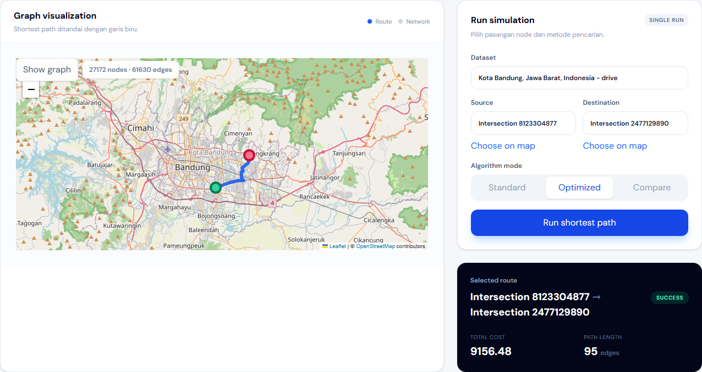
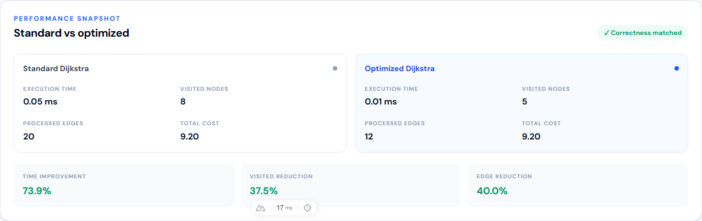
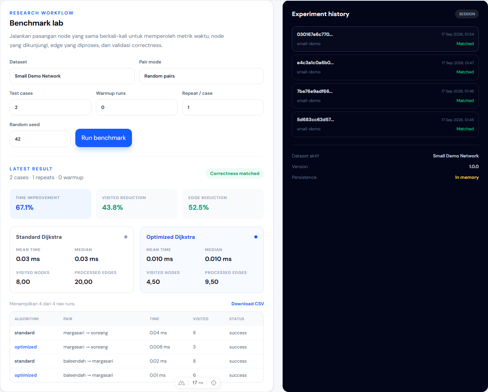
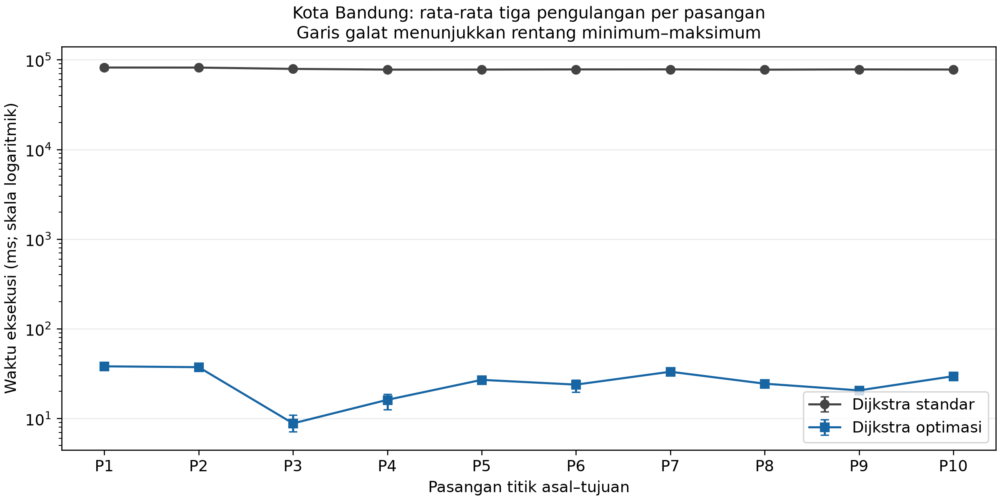

# BAB V
# IMPLEMENTASI DAN PENGUJIAN SISTEM

Bab ini membahas implementasi sistem pencarian rute dan pengujian algoritma Dijkstra standar serta Dijkstra optimasi pada jaringan jalan Kota Bandung. Pembahasan meliputi perangkat yang digunakan, pengelolaan data, implementasi algoritma dan antarmuka, serta hasil pengujian fungsional, ketepatan, dan kinerja.

## 5.1 Implementasi Perangkat Keras

Implementasi dan pengujian dilakukan pada sebuah komputer dengan spesifikasi sebagaimana ditunjukkan pada Tabel 5.1. Spesifikasi tersebut merupakan kondisi perangkat yang digunakan dalam penelitian, bukan persyaratan minimum sistem.

**Tabel 5.1 Perangkat Keras Pengujian**

| Komponen | Spesifikasi |
|---|---|
| Prosesor | Intel Core i5-1240P generasi ke-12 |
| Jumlah inti dan prosesor logis | 12 inti dan 16 prosesor logis |
| RAM terdeteksi | 8.276.021.248 byte, sekitar 7,71 GiB |

Kedua algoritma dijalankan secara berurutan pada perangkat yang sama. Untuk pengujian ulang, disarankan menggunakan perangkat dengan kapasitas setara atau lebih tinggi dan mengurangi aktivitas aplikasi lain agar variasi waktu eksekusi lebih terkendali.

## 5.2 Implementasi Perangkat Lunak

Sistem menggunakan antarmuka berbasis web dan layanan backend untuk pemrosesan graf. Konfigurasi perangkat lunak yang digunakan ditunjukkan pada Tabel 5.2.

**Tabel 5.2 Perangkat Lunak Implementasi**

| Perangkat lunak | Versi | Fungsi |
|---|---|---|
| Windows 11 | Build 26200 | Sistem operasi |
| Python | 3.13.7 | Eksekusi algoritma dan backend |
| FastAPI | 0.141.1 | Penyedia layanan API |
| Uvicorn | 0.52.4 | Server aplikasi backend |
| Nuxt | 4.5.2 | Kerangka kerja antarmuka |
| Vue | 3.5.40 | Komponen antarmuka |
| Leaflet | 1.9.4 | Penyajian peta dan rute |
| OSMnx | 2.1.1 | Pengambilan dan pengolahan awal data jaringan jalan |
| NetworkX | 3.6.1 | Pemeriksaan hasil jarak pada eksperimen |

Backend dijalankan secara lokal melalui alamat `http://127.0.0.1:8000`, sedangkan antarmuka diakses melalui `http://127.0.0.1:3000`. Data graf dimuat sebelum pengukuran waktu algoritma. NetworkX digunakan dalam skrip pemeriksaan hasil eksperimen dan tidak menjadi mesin pencarian rute pada aplikasi. Untuk reproduksi, versi dependensi dan dataset perlu dipertahankan sesuai catatan eksperimen.

## 5.3 Implementasi Database dan Penyimpanan Data

### 5.3.1 Implementasi Dataset Jaringan Jalan

Dataset jaringan jalan Kota Bandung bersumber dari OpenStreetMap dan diproses menggunakan OSMnx dengan tipe jaringan `drive`. Data diekstraksi pada 16 September 2026 pukul 00.02 WIB. Dataset versi 1.0.0 memuat 27.172 simpul dan 61.630 sisi berarah. Bobot sisi menyatakan panjang ruas dalam meter. Jumlah sisi berarah tidak identik dengan jumlah jalan fisik karena arah perjalanan dan sisi paralel tetap direpresentasikan dalam graf.

Dataset disimpan dalam berkas JSON dengan identitas `kota-bandung-osm-drive`. Setiap simpul menyimpan identitas, nama, lintang, dan bujur. Setiap sisi menyimpan identitas simpul asal, simpul tujuan, bobot, dan penanda dua arah. Sebelum digunakan, sistem memeriksa keunikan identitas simpul, keberadaan simpul yang dirujuk sisi, serta bobot yang berhingga dan tidak negatif. Dataset kemudian dikonversi menjadi adjacency list untuk digunakan oleh kedua algoritma.

**Tabel 5.3 Implementasi Struktur Data**

| Kelompok data | Atribut utama | Media penyimpanan pada pengujian |
|---|---|---|
| Metadata dataset | id, version, source, region, networkType, weightUnit, extractedAt | JSON lokal |
| Simpul | id, name, latitude, longitude | JSON dan graf dalam memori |
| Sisi | from, to, weight, bidirectional | JSON dan adjacency list |
| Ringkasan eksperimen | experimentId, datasetId, testCaseCount, repeatCount, statistik, mismatch | Memori proses dan arsip JSON lokal |
| Hasil setiap eksekusi | algoritma, pasangan titik, waktu, simpul, sisi, jarak, rute, status | Memori proses, JSON, dan CSV lokal |

### 5.3.2 Implementasi Penyimpanan Hasil Eksperimen

Sistem memiliki integrasi opsional dengan Firestore melalui koleksi `experiments` dan subkoleksi `runs`. Namun, sesi pengujian pada bab ini menggunakan mode penyimpanan dalam memori. Riwayat pada aplikasi tersedia selama proses backend masih berjalan. Hasil eksperimen penelitian juga diarsipkan sebagai JSON dan CSV agar dapat dianalisis kembali.

Dengan demikian, struktur objek hasil eksperimen telah diterapkan, tetapi persistensi Firestore yang dirancang pada BAB IV belum diverifikasi melalui pengujian ini. Arsip lokal tidak dianggap sebagai bukti keberhasilan penyimpanan pada Firestore. Penyimpanan hasil dilakukan setelah pengukuran algoritma sehingga tidak masuk ke dalam waktu eksekusi yang dibandingkan.

## 5.4 Implementasi Sistem

### 5.4.1 Implementasi Algoritma Dijkstra Standar

Dijkstra standar diimplementasikan menggunakan adjacency list dan himpunan simpul yang belum diselesaikan. Jarak awal seluruh simpul diatur menjadi tak hingga, sedangkan jarak simpul asal diatur menjadi nol. Pada setiap iterasi, algoritma memilih simpul dengan jarak sementara terkecil melalui pencarian linear, kemudian melakukan relaksasi terhadap sisi keluar simpul tersebut.

Pada implementasi baseline ini, pencarian dilanjutkan hingga semua simpul yang dapat dijangkau dari asal selesai diproses. Algoritma berhenti ketika tidak ada simpul tersisa atau jarak minimum berikutnya masih tak hingga. Rekonstruksi rute dilakukan dengan menelusuri pendahulu dari tujuan menuju asal. Versi algoritma dicatat sebagai `standard-v1-linear-scan`.

### 5.4.2 Implementasi Algoritma Dijkstra Optimasi

Dijkstra optimasi menggunakan adjacency list yang sama, dengan min-heap sebagai struktur pemilihan simpul berjarak minimum. Ketika ditemukan jarak yang lebih kecil, pasangan jarak dan identitas simpul dimasukkan ke heap. Entri yang sudah usang atau mengacu pada simpul yang telah diselesaikan dilewati.

Pencarian dihentikan ketika simpul tujuan dikeluarkan dari heap sebagai entri yang valid dan telah diselesaikan. Versi algoritma dicatat sebagai `optimized-v1-min-heap-early-termination`. Perbandingan ini mengukur gabungan perubahan pemilihan simpul dan penghentian dini; pengaruh masing-masing teknik belum dipisahkan melalui eksperimen tersendiri.

### 5.4.3 Implementasi Antarmuka Navigation Simulator

Antarmuka Navigation Simulator menyediakan pemilihan dataset, titik asal, titik tujuan, dan mode algoritma. Pengguna dapat memilih titik melalui daftar simpul atau peta. Sistem menampilkan status pencarian, total bobot jarak, jumlah sisi pada rute, dan visualisasi rute yang diperoleh.

**Gambar 5.1 Implementasi Navigation Simulator pada Dataset Kota Bandung**

Gambar 5.1 menunjukkan pencarian menggunakan Dijkstra optimasi dari simpul 8123304877 menuju simpul 2477129890. Total jarak yang ditampilkan adalah 9.156,48 meter dengan 95 sisi. Garis pada peta menghubungkan koordinat simpul sepanjang rute; karena geometri lengkap ruas tidak disertakan dalam JSON aplikasi, tampilan garis tidak selalu mengikuti seluruh kelengkungan jalan.

### 5.4.4 Implementasi Antarmuka Comparison

Antarmuka Comparison menyajikan hasil kedua algoritma dalam satu tampilan. Informasi yang ditampilkan meliputi waktu eksekusi, jumlah simpul yang diproses, jumlah sisi yang diperiksa, total bobot rute, dan kesesuaian hasil. Persentase perubahan membantu pengguna melihat perbedaan metrik antara kedua implementasi.

**Gambar 5.2 Implementasi Antarmuka Comparison pada Pengujian Fungsional Dataset Demo**

Gambar 5.2 menggunakan dataset `small-demo` untuk memperlihatkan fungsi antarmuka. Angka pada gambar tersebut tidak digunakan sebagai hasil eksperimen kinerja Kota Bandung. Hasil penelitian pada dataset Kota Bandung disajikan pada Subbab 5.5.

### 5.4.5 Implementasi Antarmuka Benchmark Lab

Benchmark Lab menyediakan pengaturan jumlah pasangan titik, metode pemilihan pasangan, jumlah pemanasan, jumlah pengulangan, dan random seed. Hasilnya berupa ringkasan waktu eksekusi, jumlah simpul dan sisi yang diproses, jumlah ketidaksesuaian, serta rincian eksekusi yang dapat diekspor melalui tombol Download CSV.

**Gambar 5.3 Implementasi Benchmark Lab pada Pengujian Fungsional Dataset Demo**

Tangkapan layar memperlihatkan pengujian fungsi dengan dua pasangan dan satu pengulangan tanpa pemanasan. Konfigurasi tersebut berbeda dari eksperimen kinerja penelitian yang menggunakan sepuluh pasangan pada dataset Kota Bandung.

### 5.4.6 Implementasi Antarmuka Experiment History

Experiment History menampilkan identitas eksperimen, waktu pelaksanaan, dataset, dan status kesesuaian hasil. Pengguna dapat memilih riwayat untuk memuat kembali hasil pada bagian Benchmark Lab. Pada mode memori, riwayat tidak bertahan setelah proses backend dihentikan.

**Gambar 5.4 Implementasi Experiment History pada Mode Memori**

## 5.5 Pengujian Sistem

### 5.5.1 Lingkungan dan Skenario Pengujian

Pengujian dilaksanakan pada 17 September 2026 menggunakan lingkungan sebagaimana dijelaskan pada Subbab 5.1 dan 5.2. Pengujian fungsional memakai dataset demo dan Kota Bandung sesuai kebutuhan skenario. Pengujian kinerja menggunakan graf Kota Bandung secara utuh, bukan potongan graf dari sepuluh pasangan titik.

**Tabel 5.4 Konfigurasi Eksperimen Kinerja**

| Parameter | Nilai |
|---|---|
| Dataset | kota-bandung-osm-drive, versi 1.0.0 |
| Jumlah simpul dan sisi berarah | 27.172 dan 61.630 |
| Pemilihan pasangan | Acak, pasangan asal–tujuan berbeda dan tidak berulang |
| Jumlah pasangan | 10 |
| Random seed | 42 |
| Pemanasan | 1 kali per algoritma per pasangan |
| Pengulangan terukur | 3 kali per algoritma per pasangan |
| Jumlah eksekusi terukur | 60, terdiri atas 30 standar dan 30 optimasi |
| Jumlah eksekusi pemanasan | 20, tidak masuk statistik |
| Urutan | Standar kemudian optimasi pada setiap pengulangan |
| Toleransi selisih jarak | 10⁻⁹ meter |
| Pengukur waktu | perf_counter_ns |

Waktu diukur sejak inisialisasi struktur pencarian hingga iterasi algoritma berakhir. Validasi titik, pemuatan dataset, rekonstruksi rute, komunikasi API, penyimpanan hasil, dan penggambaran antarmuka tidak termasuk dalam pengukuran. Simpul yang diproses adalah simpul yang diselesaikan, sedangkan sisi yang diperiksa adalah setiap entri adjacency yang dilalui saat relaksasi, termasuk sisi paralel.

### 5.5.2 Pengujian Fungsional Sistem

Pengujian fungsional dilakukan dengan memberikan masukan dan memeriksa keluaran API serta antarmuka. Pengujian algoritma pada graf kecil melengkapi pemeriksaan terhadap kondisi khusus.

**Tabel 5.5 Hasil Pengujian Fungsional**

| No. | Skenario | Hasil yang diharapkan | Hasil aktual | Status |
|---|---|---|---|---|
| 1 | Memeriksa layanan backend | API health memberikan status aktif | HTTP 200 dan status ok | Lulus |
| 2 | Memuat daftar dataset | Dataset demo dan Kota Bandung tersedia | Dataset dapat dipilih; graf Bandung memuat 27.172 simpul | Lulus |
| 3 | Membandingkan rute pada dataset demo | Jarak kedua algoritma sesuai | Jarak 9,2 satuan bobot pada kedua algoritma | Lulus |
| 4 | Mengirim identitas simpul tidak dikenal | Permintaan ditolak | API mengembalikan HTTP 422 | Lulus |
| 5 | Memilih asal dan tujuan sama pada antarmuka | Simulasi ditolak dengan pesan | Pesan titik harus berbeda ditampilkan | Lulus |
| 6 | Menjalankan benchmark demo | Ringkasan dan hasil tiap eksekusi tersedia | Dua pasangan menghasilkan empat hasil terukur dan nol mismatch | Lulus |
| 7 | Membuka riwayat eksperimen | Detail hasil dapat dimuat | Riwayat tersedia dan pemuatan detail berhasil | Lulus |
| 8 | Mengekspor hasil | CSV memuat metrik pengujian | HTTP 200; kolom executionTimeNs tersedia | Lulus |
| 9 | Menghitung rute optimasi Kota Bandung melalui antarmuka | Rute valid ditampilkan | Status success dan rute ditampilkan pada peta | Lulus |
| 10 | Memberikan bobot negatif pada model dataset | Dataset ditolak | ValidationError | Lulus |
| 11 | Mencari tujuan terputus pada graf uji | Tidak menghasilkan rute | Status unreachable, rute kosong, dan biaya null | Lulus |

Sebanyak sembilan tes otomatis backend dan enam pemeriksaan alur antarmuka selesai dengan hasil lulus. Jumlah pada tabel merupakan pengelompokan skenario, bukan penjumlahan jumlah fungsi tes. Pengujian tidak mencakup persistensi Firestore atau audit aksesibilitas menyeluruh. Pada tingkat fungsi algoritma, asal yang sama dengan tujuan dapat menghasilkan biaya nol; antarmuka simulasi menerapkan aturan tambahan agar kedua titik berbeda.

### 5.5.3 Pengujian Ketepatan Hasil Pencarian Rute

Ketepatan diperiksa melalui kesesuaian status dan jarak antara kedua algoritma, serta pembandingan dengan hasil NetworkX pada graf berbobot yang sama. Untuk setiap rute, pemeriksaan juga mencakup simpul awal dan akhir, keberadaan sisi antar-simpul, dan jumlah bobot sepanjang rute. Apabila terdapat sisi paralel, bobot minimum antar-simpul digunakan dalam pemeriksaan biaya rute yang direpresentasikan sebagai urutan simpul.

**Tabel 5.6 Hasil Pemeriksaan Ketepatan Rute**

| Pasangan | Simpul asal | Simpul tujuan | Jarak acuan (meter) | Kesesuaian seluruh pengulangan |
|---|---|---|---:|---|
| P1 | 8123304877 | 2477129890 | 9.156,48 | Sesuai |
| P2 | 1014721789 | 10187071456 | 9.990,07 | Sesuai |
| P3 | 4681200983 | 4123963951 | 4.477,10 | Sesuai |
| P4 | 4054910693 | 3115195211 | 7.827,67 | Sesuai |
| P5 | 10143074316 | 2255972227 | 11.578,81 | Sesuai |
| P6 | 9148177736 | 10184426411 | 8.304,95 | Sesuai |
| P7 | 5866940448 | 1966222861 | 10.900,28 | Sesuai |
| P8 | 6453694935 | 5447158256 | 10.937,08 | Sesuai |
| P9 | 1387999365 | 1381753714 | 10.817,82 | Sesuai |
| P10 | 2093775898 | 3959677853 | 10.145,44 | Sesuai |

Sebanyak 10 dari 10 pasangan memiliki rute yang dapat dijangkau. Seluruh 60 hasil eksekusi sesuai dengan pemeriksaan status, biaya, dan validitas rute. Tidak ditemukan pasangan yang mengalami ketidaksesuaian antara kedua algoritma pada toleransi yang ditetapkan. Jarak pada tabel dibulatkan untuk penyajian; pemeriksaan dilakukan menggunakan nilai tanpa pembulatan. Hasil ini menunjukkan kesesuaian pada sampel yang diuji, bukan bukti empiris untuk seluruh kemungkinan pasangan simpul.

Kesamaan jarak tidak mensyaratkan kesamaan urutan simpul apabila tersedia beberapa rute dengan bobot minimum yang sama. Pemeriksaan NetworkX memberi pembanding implementasi tambahan, tetapi tidak memvalidasi kelengkapan data jalan atau kondisi lalu lintas di lapangan.

### 5.5.4 Pengujian Kinerja Algoritma

Statistik dihitung dari 30 eksekusi terukur untuk setiap algoritma. Rata-rata merangkum seluruh pasangan dan pengulangan; median, minimum, maksimum, dan simpangan baku populasi menunjukkan variasi pengamatan. Pengulangan pada pasangan yang sama bukan pasangan rute independen yang baru.

**Tabel 5.7 Perbandingan Kinerja Algoritma**

| Metrik | Dijkstra standar | Dijkstra optimasi |
|---|---:|---:|
| Rata-rata waktu (ms) | 78.697,65 | 25,88 |
| Median waktu (ms) | 77.896,86 | 26,65 |
| Waktu minimum (ms) | 77.125,11 | 7,13 |
| Waktu maksimum (ms) | 86.962,58 | 40,11 |
| Simpangan baku populasi waktu (ms) | 2.176,87 | 8,91 |
| Rata-rata simpul diproses | 25.610,00 | 13.084,30 |
| Rata-rata sisi diperiksa | 59.072,00 | 30.351,80 |

Persentase pengurangan dihitung dengan rumus:

**Pengurangan (%) = ((nilai standar − nilai optimasi) / nilai standar) × 100%.**

Pada sesi pengujian ini, rata-rata waktu Dijkstra standar adalah 78.697,65 ms, sedangkan Dijkstra optimasi adalah 25,88 ms. Pengurangan rata-rata waktu mencapai 99,97%, dengan rasio waktu standar terhadap optimasi sebesar 3.041,08 kali. Rata-rata jumlah simpul yang diproses berkurang 48,91% dan jumlah sisi yang diperiksa berkurang 48,62%. Persentase dihitung sebelum pembulatan nilai pada tabel.

**Gambar 5.5 Rata-rata Waktu Eksekusi per Pasangan Titik**

Grafik menggunakan skala logaritmik pada sumbu waktu agar kedua implementasi tetap dapat dibandingkan ketika besar waktunya berbeda jauh. Titik pada grafik merupakan rata-rata tiga pengulangan setiap pasangan.

### 5.5.5 Pembahasan Hasil Pengujian

Hasil pengujian menunjukkan bahwa Dijkstra optimasi mempertahankan jarak minimum pada sepuluh pasangan yang diperiksa sekaligus membutuhkan waktu eksekusi lebih rendah secara agregat. Baseline menggunakan pencarian minimum linear dan menyelesaikan seluruh simpul yang dapat dijangkau dari asal. Pada sampel ini, baseline memproses rata-rata 25.610 simpul per eksekusi. Optimasi menggunakan min-heap dan berhenti ketika tujuan diselesaikan, dengan rata-rata 13.084,30 simpul per eksekusi.

Besarnya rasio waktu harus ditafsirkan terhadap baseline yang digunakan. Hasil tersebut tidak berarti bahwa setiap implementasi Dijkstra akan memperoleh percepatan yang sama. Pengujian belum membandingkan min-heap tanpa penghentian dini atau pencarian linear dengan penghentian dini, sehingga kontribusi masing-masing perubahan tidak dapat dinyatakan secara terpisah.

Perbedaan jumlah sisi berkaitan dengan simpul yang diselesaikan sebelum pencarian dihentikan. Pada implementasi optimasi, sisi keluar tujuan tidak diperiksa setelah tujuan diselesaikan. Sebaliknya, baseline tetap memproses simpul lain yang dapat dijangkau. Oleh karena itu, jumlah simpul dan sisi membantu menjelaskan besarnya pekerjaan pencarian, tetapi tidak langsung setara dengan penggunaan memori atau keseluruhan waktu respons aplikasi.

### 5.5.6 Keterbatasan Sistem dan Pengujian

Eksperimen menggunakan satu dataset, satu perangkat, dan sepuluh pasangan acak yang seluruhnya dapat dijangkau. Hasilnya belum mewakili seluruh pasangan titik di Kota Bandung. Pengujian kondisi tidak terjangkau hanya dilakukan sebagai pemeriksaan fungsional pada graf kecil. Kualitas hasil rute tetap bergantung pada kelengkapan dan ketepatan data OpenStreetMap serta batas wilayah ekstraksi.

Bobot yang digunakan hanya jarak, sehingga rute terpendek belum tentu memiliki waktu perjalanan tercepat. Kemacetan, perubahan akses, dan kondisi jalan secara waktu nyata belum dimodelkan. Tampilan peta menghubungkan koordinat simpul dan belum menggunakan geometri lengkap setiap ruas jalan.

Urutan eksekusi selalu standar kemudian optimasi, sehingga potensi pengaruh urutan, cache, beban sistem, dan perubahan frekuensi prosesor belum dieliminasi. Sebagian pemeriksaan aplikasi dan penyiapan lingkungan juga berlangsung pada perangkat yang sama selama sesi eksperimen. Karena itu, hasil waktu merupakan pengukuran pada kondisi sesi ini, bukan hasil laboratorium dengan beban sistem sepenuhnya dikendalikan. Penelitian belum melakukan pengujian signifikansi statistik atau eksperimen terpisah untuk mengukur kontribusi min-heap dan penghentian dini.

Selain itu, penyimpanan permanen melalui Firestore belum diverifikasi dan pengujian antarmuka belum mencakup seluruh variasi peramban, ukuran layar, maupun aksesibilitas. Pemeriksaan pada lingkungan pengembangan menampilkan peringatan kontras warna pada sejumlah teks antarmuka, sehingga kelulusan pengujian fungsi tidak berarti seluruh kriteria aksesibilitas telah terpenuhi. Batasan tersebut menjadi dasar pengembangan dan pengujian lanjutan.
